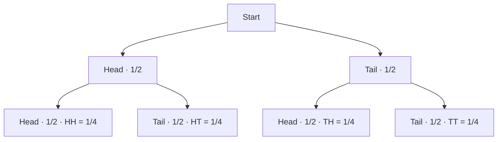

# EXAMGEN AI — P01–P09 STA171 execution package

**Source:** Belgium Campus, Applied Statistics 171/181 Study Guide 2026, Version 4.0 (January 2026), supplied as `sta171.pdf`.
**Execution branch:** `feat/p01-p09-sta171-foundation`
**Status:** Academic specification and frontend guard implemented; backend and production workflows remain unverified.

> This package is a project implementation artifact, not an institution-issued examination. Proposed blueprint weights and original sample questions below are EXAMGEN design choices. The study guide identifies outcomes and assessment criteria but does not prescribe a final examination mark total or topic weighting.

## P01 — Academic ingestion and classification

### Source metadata
- Module: Applied Statistics 171/181
- Academic year/version: 2026 / Version 4.0 (January 2026)
- NQF level: 5
- Credits: 4
- Classification: Core
- Pre/co-requisites: None stated
- Source file: `sta171.pdf` (269 pages)

### Verified learning outcomes
| ID | Outcome | Assessment criteria |
|---|---|---|
| SO1 | Introduction to Statistics | Explain the role of statistics; identify statistical language; identify data types and measurement scales; calculate significant figures |
| SO2 | Measures of Location (ungrouped) | Calculate arithmetic mean, median, mode, quartiles and percentiles |
| SO3 | Measures of Dispersion (ungrouped) | Calculate range, variance, standard deviation and coefficient of variation |
| SO4 | Measures of Location (grouped) | Calculate arithmetic mean, median, mode, quartiles and percentiles |
| SO5 | Measures of Dispersion (grouped) | Calculate range, variance, standard deviation and coefficient of variation |
| SO6 | Probability | Explain probability types/properties; explore basic concepts; calculate objective probabilities; explain rules; apply probability trees |

### Assessment evidence and cautions
- The 2026 guide says the module is assessed through one assignment, one summative test and one examination.
- The displayed assessment weights are Assignment 20% and Summative test 80%. Do not infer a separate final-examination weighting from that table.
- The guide's schedule places the examination in November 2026 and the summative test on 11 September 2026.
- Historical quiz/review material is present in the PDF. Treat it as historical evidence and worked-example material, not as a current official answer key.
- Historical records contain an apparent 66 versus 67.50 marks discrepancy. Preserve both source observations and require lecturer/source verification; do not silently reconcile them.
- Extracted formulas and diagrams must be visually checked against their rendered source pages before being promoted to verified canonical content.

### P01 status
Document identified and academic outcomes classified. Full formula-by-formula OCR verification, page-level visual QA, and normalized machine-readable import into persistent storage have not yet been demonstrated.

## P02 — Assessment blueprint

### Blueprint policy
1. Use SO1–SO6 as the source outcome taxonomy.
2. Treat weights below as a configurable demonstration blueprint, not institutional policy.
3. Support integer totals from 1 through 149 in the current project constraint; specifically test totals above 100.
4. Every question and section must have a positive integer mark value.
5. The sum of question marks must equal the blueprint total exactly.
6. Do not invent an examination duration. The historical 120-minute paper is reference evidence only; the current examination duration remains unconfirmed.
7. Permit blueprint revisions and preserve their versions.

### Demonstration blueprint: 120 marks
| Outcome | Topic | Marks | Weight |
|---|---|---:|---:|
| SO1 | Statistical foundations and significant figures | 12 | 10.00% |
| SO2 | Ungrouped measures of location | 18 | 15.00% |
| SO3 | Ungrouped measures of dispersion | 18 | 15.00% |
| SO4 | Grouped measures of location | 24 | 20.00% |
| SO5 | Grouped measures of dispersion | 24 | 20.00% |
| SO6 | Probability and probability trees | 24 | 20.00% |
| **Total** | | **120** | **100.00%** |

This is a test blueprint to prove that the design supports more than 100 marks. It is not a claim about the actual November examination.

### Suggested cognitive coverage
- Foundation: terminology, interpretation, direct one-step calculations.
- Intermediate: multi-step calculations, data interpretation, selection of appropriate methods.
- Advanced: contextual problems, comparison, conditional probability and explanation of assumptions.

The exact distribution should be configurable and reviewed against lecturer-provided requirements when available.

### Blueprint acceptance tests
- 100-mark paper: accepted.
- 120-mark paper: accepted.
- 149-mark paper: accepted.
- 150-mark paper: rejected.
- 0, negative, fractional, NaN and missing totals: rejected.
- Question marks not summing to total: rejected.
- Duplicate question IDs within a paper: rejected.
- Unmapped outcome: flagged for review.

## P03 — Original sample question bank

These are newly authored practice items aligned to the six outcomes, not copied from the historical quizzes. They are a small seed set, not a complete bank.

### Q-SO1-001 — Data classification (4 marks)
A campus team records (a) each student's programme name, (b) student satisfaction on a five-point scale, and (c) time in minutes to complete a quiz. Classify each variable by data type and measurement scale.

**Expected answer**
- Programme: qualitative/categorical, nominal.
- Satisfaction rating: categorical/ordinal.
- Completion time: quantitative, continuous, ratio.
- Award one mark for each correct classification pair, plus one mark for clear distinction between categorical and numerical data.

### Q-SO1-002 — Significant figures (2 marks)
Round 0.004567 to three significant figures.

**Answer:** 0.00457. The first three significant digits are 4, 5 and 6; the next digit is 7, so the 6 rounds up.

### Q-SO2-001 — Ungrouped location (6 marks)
For the observations 4, 6, 6, 8 and 11, calculate the mean, median, mode and range.

**Answer:** Mean = 7; median = 6; mode = 6; range = 11 − 4 = 7. Award method and result marks separately.

### Q-SO3-001 — Ungrouped dispersion (8 marks)
Treat 4, 6, 6, 8 and 11 as the complete population. Calculate the population variance, population standard deviation and coefficient of variation.

**Answer:** Mean = 7. Squared deviations sum to 28. Population variance = 28/5 = 5.6. Population standard deviation = √5.6 ≈ 2.366. Coefficient of variation = (2.366/7) × 100 ≈ 33.80%. The population convention is explicit to prevent sample/population ambiguity.

### Q-SO4-001 — Grouped location (8 marks)
A grouped distribution is shown below. Estimate the mean and median using class midpoints and the grouped median method.

| Class interval | Frequency | Midpoint |
|---|---:|---:|
| 0–<10 | 2 | 5 |
| 10–<20 | 3 | 15 |
| 20–<30 | 5 | 25 |
| **Total** | **10** | |

**Answer:** Estimated mean = (2×5 + 3×15 + 5×25)/10 = 18. Median position N/2 = 5; using the grouped median formula with median-class lower boundary 10, cumulative frequency before class 2, class frequency 3 and width 10 gives 10 + ((5−2)/3)×10 = 20. Use the exact class-boundary convention taught in the prescribed guide when assessing real submissions.

### Q-SO4-002 — Grouped mode (4 marks)
Using the same grouped table, estimate the mode with the grouped-mode formula. The modal class is 20–<30.

**Answer:** L + [(fm−fprev)/(2fm−fprev−fnext)]h = 20 + [(5−3)/(10−3−0)]×10 ≈ 22.86. State the assumed zero frequency after the final class for this illustrative table.

### Q-SO5-001 — Grouped dispersion (8 marks)
Using the same grouped table and midpoints, estimate the grouped population variance, standard deviation and coefficient of variation.

**Answer:** Mean = 18. Sum f(x−mean)² = 2(5−18)² + 3(15−18)² + 5(25−18)² = 610. Population variance = 610/10 = 61. Standard deviation = √61 ≈ 7.810. CV ≈ (7.810/18)×100 = 43.39%.

### Q-SO6-001 — Objective probability (4 marks)
A fair six-sided die is rolled once. Let A be the event of obtaining an even number and B the event of obtaining a number greater than four. Calculate P(A ∪ B).

**Answer:** A={2,4,6}, B={5,6}; A∪B={2,4,5,6}; P(A∪B)=4/6=2/3.

### Q-SO6-002 — Conditional probability (4 marks)
A bag contains three red and two blue counters. Two counters are drawn without replacement. Given that the first counter is red, calculate the probability that the second is red.

**Answer:** Two red counters remain among four counters; probability = 2/4 = 1/2.

### Q-SO6-003 — Probability tree (4 marks)
A fair coin is tossed twice. Represent the outcomes using a probability tree and calculate the probability of exactly one head.

**Answer:** HH, HT, TH, TT each has probability 1/4. Exactly one head occurs in HT or TH; probability = 2/4 = 1/2.

### Question-bank metadata contract
Each stored question must include: stable question ID, version, module ID, SO and assessment-criterion IDs, topic, type, prompt, marks, difficulty, cognitive level, options if applicable, answer key, worked explanation, marking rubric, source/provenance, authoring status, reviewer status, and duplicate fingerprint.

The objective marking contract must distinguish exact-match questions from rubric-marked questions. Do not apply approximate string matching to objective answers.

## P04 — Visual and diagram assets

### Required seed diagrams
- A grouped-frequency histogram for SO4/SO5, generated from the exact table in Q-SO4-001.
- A probability tree for Q-SO6-003, with first-branch probabilities 1/2 and second-branch conditional probabilities 1/2.
- A probability tree for Q-SO6-002, showing without-replacement branch probabilities.

### Probability tree specification

### Asset validation
Each diagram needs an asset ID, linked question ID, editable source, rendered output, alt text, dimensions, version, and reviewer status. Check branch totals, labels, mathematical consistency, legibility and PDF rendering. These are specifications; no rendered/approved image asset is claimed by this document.

## P05 — Web application and platform

### Repository inspection
- Repository: `omendi-atlan/examgen-ai`
- Default branch: `main`
- Stack: Next.js 15 App Router, React 19, TypeScript 5.7, OpenAI SDK, Zod, Docker Compose, GitHub Actions.
- Existing UI: `app/page.tsx`; frontend calls a separately deployed `/api/examinations/generate` endpoint using `NEXT_PUBLIC_EXAMGEN_API_URL`.
- Existing architecture and README describe persistence, ingestion, blueprinting, question-bank lifecycle, visual approval, rubric marking and PDF exports as planned services, not completed features.

### Implemented on this branch
- Changed the default workspace subject to Applied Statistics 171/181 and populated its six verified outcomes as initial topic text.
- Changed the visible marks input to 1–149.
- Added client-side whole-number validation rejecting marks below 1 or at/above 150.
- Added client-side duration validation for 10–240 whole minutes.
- Added explanatory UI text that explicitly supports papers above 100 marks.

### Remaining P05 work
- Enforce the same mark/duration constraints in the API (client-side checks are not a security or integrity boundary).
- Inspect and test the separately deployed API repository; it is not identified by the website README.
- Add authenticated workspaces, persistence, document ingestion, source citation, blueprint management, question-bank lifecycle, visual approvals, attempts, and audit logs.
- Preserve simulation answer-key secrecy; never send answer keys or explanations to the browser in formal mode.
- Add authorization, file validation, rate limits, retention controls and server-side audit events.

## P06 — Examination and PDF production

Required document types:
1. Student examination paper.
2. Separate examiner memorandum.
3. Blueprint and learning-outcome coverage report.
4. Question provenance and moderation report.

Each export must store immutable paper version, blueprint version, question versions, asset versions, total marks, generation timestamp and approval state. Verify PDF page order, text clipping, mathematical glyphs, image resolution, page numbering, and exact reconciliation between paper and memorandum. PDF export is not yet implemented or tested in the inspected repository.

## P07 — Independent QA

### Minimum test matrix
| ID | Area | Test | Expected result |
|---|---|---|---|
| QA-001 | Marks | Generate 100-mark paper | Accepted; total reconciles to 100 |
| QA-002 | Marks | Generate 120-mark paper | Accepted; total reconciles to 120 |
| QA-003 | Marks | Generate 149-mark paper | Accepted; total reconciles to 149 |
| QA-004 | Marks | Request 150 marks | Rejected by server validation |
| QA-005 | Marks | Fractional, zero, negative, missing marks | Rejected |
| QA-006 | Blueprint | Question sum differs from blueprint | Rejected or held for correction |
| QA-007 | Provenance | Question lacks outcome/source mapping | Flagged; cannot be approved |
| QA-008 | Objective marking | Exact correct option | Full marks |
| QA-009 | Objective marking | Wrong or incomplete exact-match response | Zero for exact-match item |
| QA-010 | Simulation | Inspect browser payload | No answer key or explanation disclosed |
| QA-011 | Persistence | Refresh/reconnect during attempt | Previously saved answers recover |
| QA-012 | Submission | Submit same attempt twice | Idempotent; no duplicate result |
| QA-013 | PDF | Export paper with diagram | Diagram present and legible |
| QA-014 | PDF | Compare paper and memorandum | IDs, marks and versions match |
| QA-015 | Security | Upload unsupported/oversized file | Rejected safely |
| QA-016 | Regression | Existing practice flow | Continues to work |

No test is marked passed until executed and its output is retained. This package defines tests; it does not claim they have run.

## P08 — Delivery, simulation and marking

### Attempt lifecycle
`CREATED → IN_PROGRESS → SUBMITTED → MARKING → MARKED → RELEASED`

Terminal/exception states: `ABANDONED`, `EXPIRED`, `VOIDED`, `MARKING_REVIEW_REQUIRED`.

Persist candidate, paper version, attempt ID, timestamps, answer revisions, autosave sequence, submission hash, marking version, marks and release state. Use server timestamps and idempotency keys. Lock submitted answers except through a separately audited moderation process.

### Marking rules
- Exact-match objective items: full marks only for the complete correct response; otherwise zero.
- Multiple-select exact match: every required choice and no disallowed choice must be selected.
- Numeric objective items: define precision/tolerance explicitly per item; never infer tolerance.
- Written answers: use approved criterion-level rubrics; retain evidence and route uncertain responses to human review.
- Practice mode may show feedback after submission.
- Formal simulation must not expose keys, explanations or scoring logic before authorized release.

Adaptive practice, moderation and topic analytics must be based on stored, versioned evidence rather than untraceable model judgments.

## P09 — Integration and release

### End-to-end release workflow
1. Ingest and verify source documents.
2. Approve outcome/topic map.
3. Approve assessment blueprint.
4. Generate and moderate question bank items.
5. Generate and approve visual assets.
6. Assemble immutable examination and memorandum versions.
7. Run P07 academic, functional, security and regression tests.
8. Publish practice or formal simulation.
9. Persist attempts and submissions.
10. Mark using the approved marking policy.
11. Release results and analytics under access controls.
12. Back up data and verify restoration before production release.

### Release gates
- No critical or high-severity open defects.
- Server-side mark validation enforces 1–149.
- All question totals reconcile.
- Formal answer keys remain private until authorized release.
- Attempt persistence and duplicate-submission protection pass.
- Paper and memorandum exports match exactly.
- Security, backup/restore, monitoring and rollback procedures are verified.

## Current honest status

| Workstream | Status |
|---|---|
| P01 source discovery and outcome classification | Completed at initial extraction; formula/visual verification outstanding |
| P02 blueprint policy and 120-mark demonstration | Specified; not yet a persisted blueprint service |
| P03 original STA171 seed questions | Authored in this document; not yet persisted in a question bank |
| P04 diagram specifications | Specified; rendered assets and approvals outstanding |
| P05 frontend marks guard and STA171 defaults | Implemented on feature branch; API enforcement and CI unverified |
| P06 PDF production | Not implemented |
| P07 QA matrix | Defined; tests not executed |
| P08 delivery/persistence/marking | Requirements defined; implementation not verified |
| P09 integration/release | Blocked by unfinished upstream services and tests |

**Do not merge or label this feature release-ready until API-side validation, tests, and the remaining acceptance gates have been completed.**
